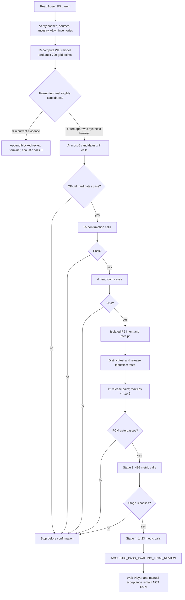

<!-- agent-doc-type: design -->
<!-- agent-doc-schema: 2 -->

# Physical Fit v5 Review Amendment 01 Design

**Status:** Approved Issue #7 / PR #8 review-code remediation  
**Contract SHA-256:** `951a0bad7fb12b92f9aa103e0caef8e0d689b13e61eda72640ee68376399c105`

## Ownership and trust boundary

The existing v5 runner, runtime record, diagnostics, history, and terminal are a frozen parent. The new review runner reads those files, rechecks their exact hashes and the v3/v4 dual-store inventories, reconstructs the local model from the 20 preserved observations, and proves that its current HEAD descends from the frozen v5 commit. It never calls a v3/v4/v5 evidence writer.

New records live in the independent `physical-fit-v5-review/continuation-01` dual-store namespace. `issue7-physical-fit-v5-review-core.cjs` owns path validation, canonical bytes, append-only writes, fsync/readback, plan identities, call markers, artifact verification, quotas, and the master lock. A partial write is preserved and reported; it is never deleted to create the appearance of a clean retry.

## Control flow

The future branch exists to exercise the state machine with a synthetic backend in temporary roots. The production CLI does not accept a renderer injection and refuses real work under this amendment. The actual frozen parent always takes the zero-candidate blocked branch.

## Reader and writer lifecycle

1. Read-only modes snapshot parent inventories and compute the audit without changing mtimes.
2. `--prepare-review` checks pushed PR HEAD, source hashes, ancestry, frozen record hashes, and parent inventories before appending the audit report and review runtime revision.
3. `--run-all` revalidates that revision and takes the review lock. It appends one blocked terminal record only when P5 still reports zero candidates and the review call ledger is empty.
4. The synthetic harness writes only to caller-supplied temporary roots. Each call is charged by writing its marker before invoking the injected backend. A successful completion requires a fully verified row and, for WAV calls, verified audio bytes. An interruption leaves an incomplete or ambiguous charged call and prevents automatic re-render.
5. Lock release verifies owner identity. A stale lock is never removed automatically.

## Call identity and immutable evidence

Call reuse compares ID, epoch, stage, plan digest, all physical values, canonical cell, artifact kind, source SHA, capture SHA, binary SHA, and fixture SHA. The original owner remains recorded as provenance; a resumed process must validate the global lock and parent revision, but need not reuse the same owner ID.

`wav` calls store an audio object and exact byte count/SHA. `metric` calls store a canonical row and reject any audio file. Both artifact types store a manifest whose digest covers the marker identity and the exact path/SHA/size list. `callCounts()` validates each started call before returning completed, incomplete, or ambiguous totals and enforces both global and per-stage caps.

## Build and acceptance separation

The synthetic release gate models independent production-test and production-release WASM identities. Different WASM SHA values or export lists are allowed. Twelve test/release pairs compare left and right PCM samples, require finite output below full scale, require zero test guard hits, and apply the fixed `1e-6` maximum absolute sample tolerance.

Stage 3 and Stage 4 metric rows bind to the same instrumented test binary SHA. Stage 4 identity also binds the exact Stage 3 result digest. A Stage 3 failure leaves Stage 4 call count zero. After a synthetic Stage 4 pass, final Web Player behavior, metadata/ABI review, PR state, and manual listening remain explicit `NOT RUN` gates.

## Failure handling

Identity drift, parent inventory changes, source changes, evidence mismatch, quota overflow, safety failures, ambiguous calls, failed official gates, release PCM mismatch, and Stage 3 failure stop the next stage. Synthetic outputs are labelled synthetic in all reports and cannot satisfy the real acoustic requirement. No threshold, cell set, parameter bound, or terminal result is relaxed to turn a failure into a pass.
